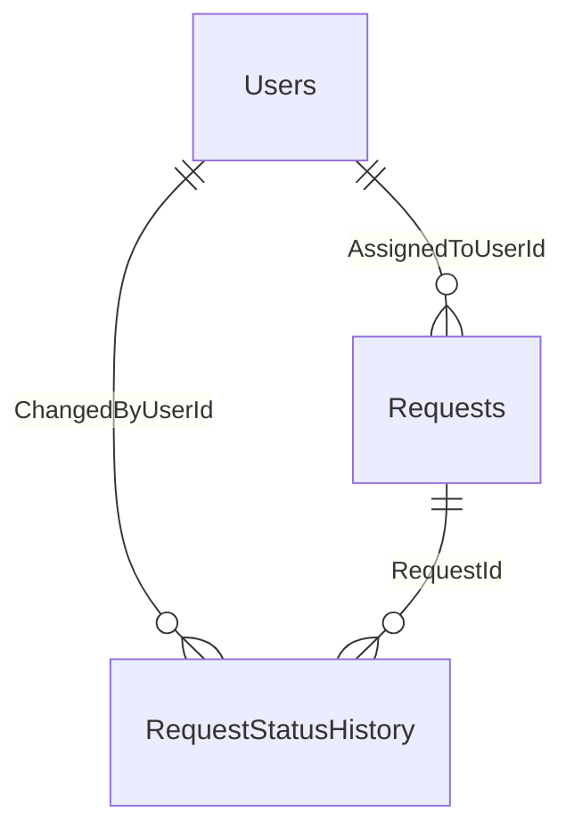

# סכמת מסד הנתונים

## טבלאות

### Users
משתמשים שמטפלים בפניות ומבצעים שינויי סטטוס.

| עמודה | סוג | הערה |
|-------|-----|------|
| Id | INT IDENTITY | PK |
| UserName | NVARCHAR(100) | ייחודי (`UQ_Users_UserName`) |
| DisplayName | NVARCHAR(200) | |
| Email | NVARCHAR(256) NULL | |
| IsActive | BIT | ברירת מחדל 1 |
| CreatedAt | DATETIME2(3) | UTC |

### Requests
| עמודה | סוג | הערה |
|-------|-----|------|
| Id | INT IDENTITY | PK |
| Title | NVARCHAR(200) | |
| OrganizationName | NVARCHAR(200) | |
| Status | TINYINT | 0=New, 1=InProgress, 2=Waiting, 3=Completed (CHECK 0–3) |
| Priority | TINYINT | 0=Low, 1=Medium, 2=High (CHECK 0–2) |
| AssignedToUserId | INT NULL | FK ל-Users; NULL = לא משויך |
| CreatedAt / UpdatedAt | DATETIME2(3) | UTC |
| RowVersion | ROWVERSION | טוקן Optimistic Concurrency; SQL Server מעדכן אותו אוטומטית בכל UPDATE |

### RequestStatusHistory
רשומה לכל שינוי סטטוס (Audit).

| עמודה | סוג | הערה |
|-------|-----|------|
| Id | BIGINT IDENTITY | PK |
| RequestId | INT | FK ל-Requests |
| PreviousStatus / NewStatus | TINYINT | CHECK 0–3 |
| ChangedAt | DATETIME2(3) | UTC |
| ChangedByUserId | INT | FK ל-Users |

### החלטות עיצוב
- **Status/Priority כ-TINYINT** ולא מחרוזת: קטן יותר, אינדקסים יעילים יותר, ו-CHECK מבטיח ערכים חוקיים. ההמרה ל-Enum נעשית בשכבת ה-API.
- **AssignedTo כ-FK למשתמש** ולא טקסט חופשי: שלמות נתונים והצגת שם משתמש.
- **ROWVERSION**: מנגנון מובנה של SQL Server; מבטיח זיהוי עדכונים מקבילים ברמת ה-DB.
- **DATETIME2 ב-UTC**: ללא תלות באזור זמן של השרת.

## אינדקסים

כל אינדקס על `Requests` (פרט ל-Title) מסיים ב-`CreatedAt DESC`, כך שהמיון ברירת המחדל (החדשות ביותר) מתבצע מהאינדקס.

| אינדקס | עמודות | משרת |
|--------|--------|------|
| `IX_Requests_Status_CreatedAt` | Status, CreatedAt DESC, INCLUDE Priority | סינון לפי סטטוס; Aggregation לפי סטטוס (covering) |
| `IX_Requests_Priority_CreatedAt` | Priority, CreatedAt DESC | סינון לפי עדיפות; Aggregation לפי עדיפות |
| `IX_Requests_AssignedToUserId_CreatedAt` | AssignedToUserId, CreatedAt DESC | סינון לפי משויך; תומך ב-FK |
| `IX_Requests_OrganizationName_CreatedAt` | OrganizationName, CreatedAt DESC | סינון ארגון (`LIKE 'abc%'`). Seek רק כשהפילטר סלקטיבי; אחרת ה-Optimizer בוחר סריקה, וזה זול יותר (נמדד, ראו [performance.md](performance.md)) |
| `IX_Requests_Title` | Title | מיון לפי כותרת בלבד (החיפוש בכותרת הוא `Contains`, ולכן אינו משתמש באינדקס) |
| `IX_Requests_CreatedAt` | CreatedAt DESC | טווח תאריכים; מיון ברירת מחדל |
| `IX_Requests_UpdatedAt` | UpdatedAt DESC | מיון לפי עדכון אחרון |
| `IX_RequestStatusHistory_RequestId_ChangedAt` | RequestId, ChangedAt DESC | שליפת היסטוריה של פנייה, החדש ראשון |

### למה האינדקסים האלה, ומה נמדד

- **העיקרון:** כל אינדקס משרת פילטר או מיון אחד, ו-`CreatedAt DESC` הוא העמודה האחרונה, כדי שמיון ברירת המחדל (החדש ראשון) יגיע מהאינדקס בלי Sort, וטווח תאריכים יהיה Range על אותו אינדקס.
- **נמדד:** עמוד ראשון ללא פילטר: 183 קריאות (במקום סריקה של 1,565), סינון לפי סטטוס + עדיפות + תאריכים: 162, ו-Aggregations: 285-335 (במקום 1,565). פירוט ב-[performance.md](performance.md).
- **אינדקסים שנבדקו ולא הועילו:** אינדקס על ארגון הוא Seek רק לארגון סלקטיבי (ראו טבלה). אין אינדקס לחיפוש חופשי, כי `LIKE '%x%'` אינו יכול להשתמש באינדקס רגיל.
- **מיון בלי אינדקס ייעודי:** מיון לפי `Status`, `Priority` או `OrganizationName` כשלעצמו לא נמדד, ולא נוסף לו אינדקס ייעודי. זו בחירה מודעת: אלה שדות עם מעט ערכים או שימוש נדיר, ואינדקס נוסף מאט כתיבות.

### מגבלה ידועה
חיפוש הטקסט החופשי (`search`) ב-API משתמש ב-`Contains` ולכן סורק, וזה מפורט ב-[requests-list-page.md](requests-list-page.md#איך-נמנעת-טעינת-כלל-הנתונים-לזיכרון). רק פילטר הארגון הוא prefix (`StartsWith`) ומנצל אינדקס. החלופה לפרודקשן: Full-Text Search (לא זמין ב-LocalDB).

### עלות
7 אינדקסים מאטים מעט כתיבות (במערכת הזו הקריאות דומיננטיות). ניתוח Execution Plan ושיפורים מתועדים ב-[performance.md](performance.md).

## Aggregations
שאילתות הדוגמה ב-`database/aggregations-examples.sql`: ספירה לפי סטטוס, לפי עדיפות, ופניות פתוחות לפי משתמש. הראשונות מכוסות על ידי האינדקסים של Status ו-Priority.
