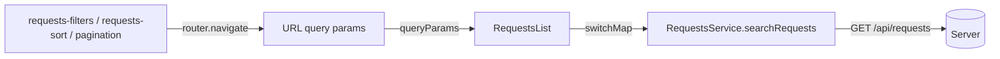

# עמוד פניות (Requests List)

עמוד `/requests` מציג את הפניות לפי חיפוש, סינון ומיון, עם עימוד בצד השרת. הוא נפתח אוטומטית כשמבצעים חיפוש או סינון ב-Dashboard.

## התנהגות

- **מעבר מה-Dashboard:** חיפוש או סינון ב-Dashboard מנווטים ל-`/requests` עם הפרמטרים ב-URL.
- **בראש העמוד:** חיפוש חופשי וסינון מתקדם (אפשר לחפש מחדש), כפתורי מיון, וקישור "חזרה לפילוח הפניות".
- **במרכז:** כרטיסי פניות (20 בעמוד) ועימוד.
- **מצבי תצוגה:** טעינה ראשונה, ריק ("לא נמצאו פניות"), שגיאה (עם "נסה שוב" כשרלוונטי).

## זרימת הנתונים



הקומפוננטות לא קוראות לשרת ולא מחזיקות את מצב החיפוש. כל שינוי מעדכן את ה-URL, וה-`RequestsList` מגיב לשינוי ב-`queryParams` ושולח בקשה.

## מבנה הקבצים (`client/src/app`)

```
components/
  dashboard/
  requests-list/          עמוד הפניות (מנהל מצב וטעינה)
    request-card/         כרטיס פנייה (תצוגה בלבד)
    requests-sort/        כפתורי מיון
    pagination/           עימוד
  shared/                 קומפוננטות לשימוש כמה עמודים
    requests-filters/     חיפוש וסינון
models/                   טיפוסים (RequestListItem, PagedResult, RequestSort, ...)
services/
  api/                    requests.service.ts: קריאות לשרת
  utils/                  api-error.utils.ts, request-filters.utils.ts
```

## פרמטרים ל-`GET /api/requests`

| פרמטר | תיאור |
|---|---|
| `search` | חיפוש חופשי בכותרת ובשם הארגון |
| `status`, `priority` | סינון לפי סטטוס / עדיפות |
| `organizationName`, `assignedTo` | סינון לפי ארגון / מטופל |
| `createdFrom`, `createdTo` | טווח תאריכי יצירה |
| `sortBy` | `CreatedAt` (ברירת מחדל), `UpdatedAt`, `Title`, `OrganizationName`, `Status`, `Priority` |
| `sortDirection` | `Asc` / `Desc` (ברירת מחדל `Desc`) |
| `page`, `pageSize` | עימוד (`pageSize` עד 100, בעמוד 20) |

התגובה: `{ items, page, pageSize, totalCount, totalPages }`. ערכים ריקים ו-ברירות מחדל לא נשלחים.

## איך נמנעת טעינת כלל הנתונים לזיכרון

כל העבודה מתבצעת ב-SQL Server, ב-`RequestsRepository.SearchAsync`:

1. השאילתה נבנית כ-`IQueryable` (`AsNoTracking`). `ApplyFilters` מוסיף `Where` לכל פילטר שנשלח, בלי להריץ כלום.
2. `CountAsync` מחזיר `totalCount` (שאילתת `COUNT` אחת).
3. `ApplySort` + `Skip/Take` מתורגמים ל-`ORDER BY ... OFFSET ... FETCH`, ו-`Select` ל-DTO מביא רק את העמודות הנדרשות.
4. רק אז `ToListAsync`: לזיכרון נטענים לכל היותר `pageSize` שורות (מקסימום 100, ברירת מחדל 20), מתוך 100K ומעלה.

הלקוח לעולם לא מקבל את כל הרשומות, ולא מסנן, ממיין או מחלק לעמודים בעצמו. גם `pageSize` נחסם בשרת (עד 100). ה-Aggregations (`GROUP BY`) רצים גם הם ב-SQL.

## אינדקסים לפי תרחיש חיפוש

פירוט האינדקסים ב-[database-schema.md](database-schema.md#אינדקסים).

| תרחיש | אינדקס | התנהגות |
|---|---|---|
| סינון לפי סטטוס (+ מיון ברירת מחדל) | `IX_Requests_Status_CreatedAt` | Seek, והמיון לפי `CreatedAt DESC` מגיע מהאינדקס |
| סינון לפי עדיפות | `IX_Requests_Priority_CreatedAt` | כנ"ל |
| סינון לפי משויך | `IX_Requests_AssignedToUserId_CreatedAt` | Seek לפי `AssignedToUserId`; אבל הפילטר בטקסט (`Contains` על שם המשתמש) סורק את טבלת `Users` הקטנה, ואחר כך מתחבר ל-`Requests` דרך האינדקס |
| טווח תאריכים / מיון ברירת מחדל | `IX_Requests_CreatedAt` | Range seek. גבול עליון בלעדי (`< חצות של היום הבא`) כדי להישאר ידידותי לאינדקס |
| סינון ארגון | `IX_Requests_OrganizationName_CreatedAt` | `StartsWith` הופך ל-`LIKE 'text%'`, אבל בפועל נבחרת סריקה כשהפילטר רחב (ראו [performance.md](performance.md)); Seek משתלם רק בארגון סלקטיבי מאוד |
| מיון לפי כותרת / עדכון אחרון | `IX_Requests_Title`, `IX_Requests_UpdatedAt` | המיון מגיע מהאינדקס |
| חיפוש חופשי (`search`) בכותרת ובשם הארגון | אין אינדקס מתאים | `Contains` הופך ל-`LIKE '%text%'` ולכן סריקה (Scan) |

### חיפוש חופשי: מגבלה מודעת

`search` מחפש באמצע המילה בכותרת ובשם הארגון, וזה לא יכול להשתמש באינדקס רגיל. הנימוק: חיפוש "מכיל" נדרש מבחינת המשתמש, ו-100K שורות הן עדיין סריקה סבירה. הצמצום: כשמוסיפים עוד פילטר (סטטוס, תאריכים וכו') SQL Server מצמצם קודם לפי האינדקס, ורק אז מסנן את הטקסט על השורות שנותרו. החלופה לפרודקשן: Full-Text Search (לא זמין ב-LocalDB).

ניתוח Execution Plan מול 100K רשומות מתועד ב-[performance.md](performance.md).

## מיון

- **שרת:** רשימה לבנה של שישה שדות (לא שם עמודה גולמי מהלקוח), לכן אין הזרקה. `Id` משמש כ-tie-breaker כדי שהעימוד יישאר יציב כשערכי המיון שווים. `Status` ו-`Priority` נשמרים כ-`byte`, ולכן ממוינים לפי סדר לוגי ולא לפי האלפבית.
- **קלינט:** כפתור לכל שדה. לחיצה על שדה לא פעיל בוחרת אותו עם כיוון ברירת מחדל (תאריכים ועדיפות יורדים, השאר עולים). לחיצה על שדה פעיל הופכת כיוון (↑/↓).

## החלטות

1. **ה-URL הוא מקור האמת למצב החיפוש (פילטרים, מיון, עמוד).**
   - נבחר כדי שרענון, כפתור "אחורה" ושיתוף קישור יעבדו, ובלי מצב משותף בין עמודים.
   - חלופה שנדחתה: Service עם state משותף. פשוט יותר, אבל נאבד את המצב ברענון.
   - ברירות מחדל לא נכתבות ל-URL, וערכים לא תקינים חוזרים לברירת המחדל.
2. **שינוי פילטר או מיון מחזיר לעמוד 1; מעבר עמוד שומר עליהם.**
3. **`switchMap` מבטל בקשה ישנה** כשמגיעה חדשה, כדי שרק התשובה האחרונה תוצג. `catchError` נמצא בתוך ה-`switchMap`, כך ששגיאה אחת לא מסיימת את ה-stream.
4. **תוצאות קודמות נשארות מעומעמות בזמן טעינה** (ולא "טוען..."), כדי למנוע הבהוב. טקסט הטעינה מופיע רק בטעינה הראשונה. בכל טעינה העמוד גולל לראש.
5. **ולידציית קלט בקלינט, שגיאות שרת דרך Middleware.**
   - טווח תאריכים הפוך נחסם בטופס עם הודעה, והכפתור מנוטרל.
   - השרת עדיין מאמת (גיבוי), אבל ההודעה למשתמש נוצרת בקלינט.
   - חריגות לא מטופלות עוברות ב-`GlobalExceptionHandler` (`IExceptionHandler`) ומחזירות 500 בפורמט ProblemDetails עם הודעה בעברית ב-`detail` (פרטים טכניים נכתבים ללוג בלבד). ביטול בקשה על ידי הלקוח לא מחזיר שגיאה.
   - `toApiError` בקלינט מציג את `detail` של השרת. 400 אינו ניתן לניסיון חוזר.
6. **חלוקה לקומפוננטות:** `RequestsList` מנהל מצב; `request-card`, `requests-sort` ו-`pagination` הם קומפוננטות תצוגה ללא תלות בשרת ונמצאים בתוך `requests-list`; `requests-filters` ב-`shared` כי משמשת כמה עמודים. קבצי עזר ב-`services/utils`, קריאות לשרת ב-`services/api`.

7. **`errorInterceptor` גלובלי בקלינט** (`services/interceptors`, רשום ב-`app.config.ts`).
   - כל שגיאת HTTP מומרת במקום אחד ל-`ApiError` (`status`, `message`, `retryable`) ונרשמת ל-console, כך שקומפוננטות לא מפענחות `HttpErrorResponse`.
   - ההודעה היא ה-`detail` מהשרת, ואם אין - טבלת גיבוי לפי סטטוס (0, 404, 409) או הודעה כללית.
   - `toApiError` אידמפוטנטית, ולכן קומפוננטות שמקבלות כבר `ApiError` ממשיכות לעבוד.
   - ביחד עם `GlobalExceptionHandler` בשרת: השרת מחזיר ProblemDetails אחיד והקלינט מציג אותו.

## מגבלות ושיפורים עתידיים

- הודעות הולידציה של השרת (400) באנגלית; הקלינט מונע את המקרים הנפוצים לפני השליחה.
- `pageSize` קבוע (20) ואינו נבחר על ידי המשתמש.
