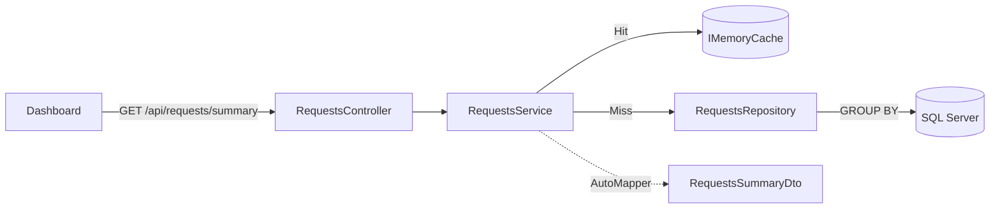

# פילוח פניות (Aggregations) – Dashboard

שני פילוחים למסך הראשי: **כמות פניות לפי סטטוס** ו**כמות פניות לפי עדיפות**.

## זרימת הנתונים



1. **Angular** (`RequestsService.getSummary`) קורא ל-`GET /api/requests/summary`.
2. **Controller** מעביר את הבקשה (עם `CancellationToken`) לשירות ומחזיר DTO.
3. **BLL** (`RequestsService.GetSummaryAsync`) בודק Cache. ב-Miss הוא קורא ל-Repository פעמיים, ממפה ל-DTO ב-AutoMapper ומחשב `Total`.
4. **DAL** (`GetCountByStatusAsync`, `GetCountByPriorityAsync`) מריץ `GROUP BY` ב-SQL Server.
5. **Angular** מציג תוויות וצבעים (`models/request-display.ts`) ומשלים 0 לערכים שלא הוחזרו.

## תגובת ה-API

```json
{
  "total": 100000,
  "byStatus":   [ { "key": "New", "count": 40025 }, ... ],
  "byPriority": [ { "key": "High", "count": 19911 }, ... ]
}
```

## התאמה לדרישות

| דרישה | מימוש |
|---|---|
| לפחות 2 Aggregations | לפי סטטוס ולפי עדיפות |
| בלי טעינה מלאה לזיכרון | `GroupBy` + `Count` מתורגמים ל-`GROUP BY` ב-SQL; חוזרות 3–4 שורות בלבד |
| `async` + `CancellationToken` | בכל השכבות, עד `ToListAsync(cancellationToken)` |
| DTO ולא Entity | ה-DAL מחזיר `GroupCount<T>`; ה-API מחזיר `RequestsSummaryDto` (מיפוי ב-AutoMapper, `Bll/Mapping`) |
| קריאה בלבד | `AsNoTracking()` |
| אינדקסים | `IX_Requests_Status_CreatedAt` ו-`IX_Requests_Priority_CreatedAt` (ראו [database-schema.md](database-schema.md)) |
| Cache | ראו להלן |

SQL שנוצר (EF Core):

```sql
SELECT [r].[Status], COUNT(*) FROM [Requests] AS [r] GROUP BY [r].[Status]
SELECT [r].[Priority], COUNT(*) FROM [Requests] AS [r] GROUP BY [r].[Priority]
```

## Cache

- **מה נשמר:** הסיכום המלא (מפתח `requests-summary`). הוא נקרא בכל כניסה למסך, ואילו חישובו דורש סריקת אינדקס על 100K שורות.
- **תפוגה:** 5 דקות (Absolute), כרשת ביטחון בלבד.
- **Invalidation:** `InvalidateSummaryCache()` מוחק את הערך אחרי עדכון בודד שהשתנה בו סטטוס או עדיפות, ואחרי עדכון מרוכז שהצליח בו לפחות פנייה אחת, כדי שלא יוצגו נתונים ישנים.
- **כמה שרתים:** `IMemoryCache` מקומי לכל שרת. בסביבה מבוזרת יש לעבור ל-`IDistributedCache` (Redis) עם אותו מפתח, ולנקות דרכו.
- פירוט מלא: [cache.md](cache.md).

## הנחות ומגבלות

- לכל פנייה חובה סטטוס ועדיפות (לפי הסכמה), לכן אין טיפול ב-NULL.
- ערך שאין לו פניות לא חוזר מהשרת; הקליינט מציג אותו כ-0.
- ב-Miss מקבילי כמה בקשות עלולות לחשב את הסיכום במקביל. זה לא פוגע בנכונות.
- Execution Plan מול 100K רשומות: ראו [performance.md](performance.md).
